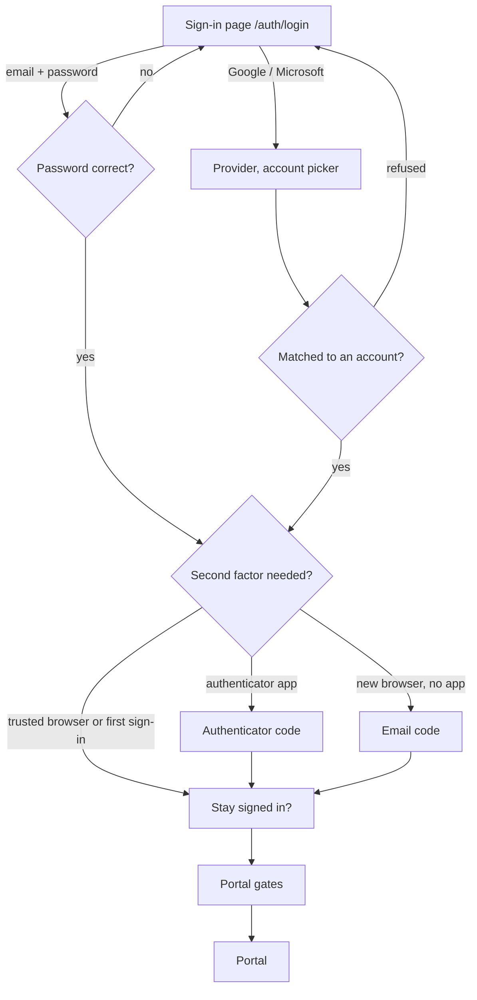
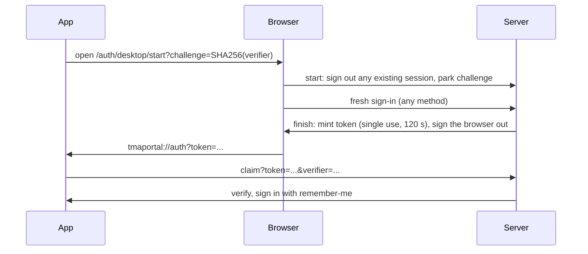

# Authentication - Architecture

**Status:** built and in production. Last reviewed 19 November 2026.

This replaces the original design-phase specification, whose static prototype
under `public/auth/` has since been removed; the real screens live in
`resources/views/auth/`. Where the build departs from the original decisions,
[section 13](#13-changes-from-the-original-design) says so.

Related: [`docs/security-hardening-2026-09.md`](docs/security-hardening-2026-09.md)
(hardening pass, geographic and VPN rules),
[`docs/security-pentest-brief.md`](docs/security-pentest-brief.md), and
[`docs/android-api-catalogue.md`](docs/android-api-catalogue.md) (the session and
cookie contract the apps rely on).

---

## 1. At a glance

| Concern | Where |
|---|---|
| Sign-in engine | Laravel Fortify, routes under `/auth` - [`config/fortify.php`](config/fortify.php), [`FortifyServiceProvider`](app/Providers/FortifyServiceProvider.php) |
| Google, Microsoft, Apple | Socialite - [`SocialAuthController`](app/Http/Controllers/SocialAuthController.php), [`AppleCallbackController`](app/Http/Controllers/AppleCallbackController.php) |
| Second factor | Authenticator app (Fortify TOTP) or an emailed code - `App\Support\LoginChallenge`, `EmailTwoFactor`, `EmailLoginCode` |
| Trusted browser, "Stay signed in?" | `App\Support\TrustedDevices`, `App\Support\StaySignedIn` |
| Session lifetime | `SecurityPolicies::sessionDays()`, `EnforceSessionExpiry` |
| Portal gates | middleware chain on the portal route group ([section 5](#5-gates-on-the-portal)) |
| Desktop, iOS and Android apps | browser hand-off - [`DesktopAuthController`](app/Http/Controllers/DesktopAuthController.php) ([section 7](#7-desktop-ios-and-android-apps)) |
| Administrator "Sign in as" | `App\Support\Access\Impersonation` ([section 8](#8-administrator-sign-in-as)) |
| Abuse controls | Turnstile, rate limits, breached passwords, geo/VPN rules, detectors ([section 10](#10-abuse-controls)) |
| Audit | `auth_events`, `storage/logs/security.log` ([section 11](#11-audit)) |

---

## 2. Signing in

### Email and password

Fortify's pipeline, with the second-factor step replaced
(`config/fortify.php` -> `pipelines.login`):

1. `CanonicalizeUsername` lowercases the email.
2. [`RedirectIfTwoFactorAuthenticatable`](app/Actions/Fortify/RedirectIfTwoFactorAuthenticatable.php) checks the password once, then applies the second-factor rules ([section 3](#3-second-factor)).
3. `AttemptToAuthenticate`, then `PrepareAuthenticatedSession`, which rotates the session ID.
4. [`LoginResponse`](app/Http/Responses/LoginResponse.php) stamps `users.last_authenticated_at`, runs `StaySignedIn::afterAuthenticated()`, then sends the person to the dashboard.

**Every sign-in lands on the dashboard** (`SafeIntended::landing()`), whatever
the method: password, email code, authenticator, Google, Microsoft, Apple, or
the "Stay signed in?" answer. A page parked before sign-in is dropped, whether
a session that ended mid-page sent the browser to the sign-in screen or a
signed-out visit tried to open it. Only two parked addresses continue, because
they are steps of a flow rather than a page: the app hand-off
(`/auth/desktop/finish`) and an invitation being accepted (`/invite/{token}`).
Only their path is used, so a parked address can never lead off the site.

Errors never say which field was wrong. Attempts are limited to 5 a minute per
email and IP address.

### Google and Microsoft

- `GET /auth/social/{provider}/redirect` -> the provider -> `GET /auth/social/{provider}/callback`.
- The request always carries `prompt=select_account`, so the provider shows its account picker even when the browser is already signed in there. The one exception is the silent retry after a failed handshake (`retry=1`), which reuses the account the person has just picked.
- Matching happens in this order (`SocialAuthController::authenticate`):
  1. An invitation carried through the round trip is checked first. A provider account with a different email bounces back to the invitation.
  2. The provider identity is already linked (`connected_accounts`): sign in as that account. A deleted account is refused.
  3. The provider has not verified the email: refused.
  4. The email belongs to a deleted account: refused.
  5. The email matches an account: the provider is linked to it and the email counts as verified.
  6. No account: one is created, pending administrator approval, and the `Registered` event fires exactly as for the password form.
- Every path then goes through the same second-factor rules as a password sign-in.
- **Connecting** a provider while signed in (`/connect/{provider}`, or Security settings) is refused if that provider identity belongs to another account. Google and Microsoft must carry the same verified email as the portal account, because they bring a mailbox and calendar. Apple is exempt: it often hands out a relay address, and the person has already proved who they are.

### Apple

- On the web, Apple posts back to `POST /auth/social/apple/callback` (form post, registered in [`bootstrap/app.php`](bootstrap/app.php)).
- In the iOS app, the native Sign in with Apple sheet is used. Its credential and a nonce are posted from inside the web view to `POST /auth/social/apple/native`.
- Apple has no account-picker parameter.

### Other ways a session starts

| Path | Where |
|---|---|
| Accepting an invitation | `InvitationAcceptController` |
| Opening the email-verification link, on any device | `UnsignedVerifyEmailController` (the link is signed and bound to the user ID and email) |
| Finishing an email code | `EmailTwoFactorController` |
| A desktop or mobile app claiming a browser sign-in | `DesktopAuthController::claim` ([section 7](#7-desktop-ios-and-android-apps)) |
| An administrator opening an account | `Impersonation::start` ([section 8](#8-administrator-sign-in-as)) |

---

## 3. Second factor

`App\Support\LoginChallenge` decides, for every sign-in method:

| Situation | What happens |
|---|---|
| Authenticator app set up, browser not trusted for this account | Authenticator code (Fortify's challenge). "Email me a code instead" is offered. |
| No authenticator app, browser not trusted, has signed in before | Six-digit email code at `/auth/login-code` |
| First sign-in ever | No second step |
| Browser trusted for this account | No second step |

- **Email codes** (`EmailLoginCode`): valid for 10 minutes, stored only as a hash on the parked half-finished sign-in, never in a shared cache. They can be re-sent every 30 seconds, and entering one is limited to 5 tries a minute.
- **Authenticator app**: Fortify's TOTP, which works with any RFC 6238 app. Setting it up requires confirming a code; changing it requires the password; codes are accepted one step either side. Recovery codes are Fortify's: stored encrypted with the app key, each usable once.
- **Required authenticator**: an administrator can require it for one person (`users.require_two_factor`) or for whole account types (Sign-in policy). `EnforceTwoFactor` (`mfa.enforced`) holds the person on `/auth/required-authenticator` until it is set up, and JSON callers get JSON rather than a redirect. `PreventDisablingRequiredAuthenticator` blocks turning it off.
- **Trusted browser**: the `tma_trusted_device` cookie (HttpOnly, SameSite=Lax) holds a token whose hash is stored in `trusted_devices` **against one account**. Another account signing in on the same browser is not trusted by it. It is issued when the person ticks "Trust this browser" on a code screen or answers yes to "Stay signed in?", and lasts the configured number of session days.

---

## 4. After sign-in: "Stay signed in?"

`StaySignedIn::afterAuthenticated()` runs after every sign-in method:

- The browser is trusted, or "Trust this browser" was ticked: a remember-me cookie is issued and nothing is asked.
- The browser has never answered: the person is sent to `/auth/stay-signed-in`, and `EnsureStaySignedInChoice` keeps them there until they answer. Signing out and the code screens are exempt.
- The browser answered yes before: remember-me is applied again.

The answer is stored per browser in the `tma_device_trust` cookie (`yes` or `no`).
The remember-me cookie lasts the configured number of session days.

---

## 5. Gates on the portal

Every portal route runs these in order:
`auth` -> `verified` -> `profile.complete` -> `account.approved` -> `onboarded` -> `mfa.enforced`.

| Gate | Holds the person on |
|---|---|
| `verified` | Email verification |
| `profile.complete` | `/auth/profile-setup` |
| `account.approved` | `/auth/pending` until an administrator approves the account, `/auth/role-pending` for the retired Employee type. A suspended account is signed out. |
| `onboarded` | Client onboarding (`/onboarding`), the staff getting-started checklist, or unfinished account setup |
| `mfa.enforced` | `/auth/required-authenticator` |

Every `web` request also passes `RequireSecureTransport`, `EnforceGeoAccess` and
`VerifyTurnstile` first, and `IssueTrustedDeviceCookie`,
`EnsureStaySignedInChoice`, `EnforceSessionExpiry` and
`PreventDisablingRequiredAuthenticator` after ([`bootstrap/app.php`](bootstrap/app.php)).

---

## 6. Sessions, expiry and signing out

**Storage.** Sessions live in the `sessions` table through
`ThrottledDatabaseSessionHandler`, which skips writes that change nothing and
refreshes `last_activity` every 5 minutes. [`config/session.php`](config/session.php)
maps `cookie` to `database`, because Laravel Cloud injects `cookie`. It must
stay on the database driver: the session list, revoking a session, "Log out of
all devices", the password reset's "sign out everywhere" and an
administrator's force sign-out all work on that table. `.env.example` defaults
to `database` for the same reason.

**Cookie.** The payload is encrypted. The cookie is HttpOnly and SameSite=Lax,
Secure over HTTPS, and serialized as JSON.

**One number governs lifetime**: session days (Account settings -> Sign-in,
default 7, allowed 1-30). It sets:

- the idle lifetime,
- the remember-me cookie,
- the trusted-browser lifetime,
- the absolute cap: `EnforceSessionExpiry` signs the person out once `users.last_authenticated_at` is older than that. Only a real proof (password, provider or code) refreshes the stamp; a remember-me restore does not. An administrator can also set a cut-off that forces everyone to sign in again (`SecurityPolicies::forceReauthAfter`).

**Signing out** ([`public/js/sign-out.js`](public/js/sign-out.js)):

- The browser sends a JSON `POST /auth/logout` (answered `204`), retries once on `419`, and falls back to a plain form post.
- It clears the tab's cached data, then goes to `/auth/login?from=logout`, which drops any page parked for after sign-in.
- The server invalidates the session, rotates the CSRF token, clears the remember-me cookie and rotates the account's remember token. Remember-me cookies on the person's other devices stop working, though their open sessions continue until they expire. Push tokens registered by that session are deleted.

**Ending other sessions:**

- **"Log out of all devices"** (Security settings, and Account settings) asks for the current password, is limited to 6 tries a minute, and deletes the account's other `sessions` rows. An account made with Google or Microsoft has no password of its own, so it is told to create one first.
- Single sessions can be revoked from Security settings. The page identifies them by a digest, never the raw session ID.
- A password reset offers "sign out everywhere" (ticked by default). It deletes the sessions, clears the remember token and forgets trusted browsers. A confirmation email is always sent.

**What a browser keeps.** No account data is written to disk in a browser; only
the desktop app keeps a disk copy. The per-tab cache is filed under the account
ID and wiped the moment a different account answers `/me`. The portal page is
served `no-store`, because it embeds the reader's capabilities.

---

## 7. Desktop, iOS and Android apps

Google refuses sign-in inside embedded web views, so provider sign-ins in the
apps happen in the system browser and come back over the `tmaportal://`
scheme. The exchange is shaped like PKCE, because any app on the machine could
register that scheme.

- `start` signs out any session the browser already holds, and its remember-me cookie, before parking the challenge. A browser that is already signed in is never handed back as it is.
- `finish` signs the browser out once the token is minted, so the browser leg leaves nothing signed in behind.
- Both use `logoutCurrentDevice()`: the person's remember token is not rotated (which would end "Stay signed in" on their other devices), and no `Logout` event fires (this is not a sign-out the person made).
- The token is worth nothing without the verifier, which never leaves the app.
- Email-and-password sign-in in the desktop app happens inside the app. Only provider sign-ins use the hand-off.
- iOS uses `ASWebAuthenticationSession` (which shares Safari's cookies), Android uses Custom Tabs, and the desktop uses the default browser. Native Sign in with Apple on iOS does not use the hand-off.
- The desktop app's "Clear Session" menu wipes its cookies and local storage.

---

## 8. Administrator "Sign in as"

- An administrator can open the portal as a service-provider account (`Impersonation::start`). The session becomes that account. The administrator's ID stays in the session (`impersonator_id`) for the way back and for the audit trail.
- It is not a sign-in: no `auth_events` row, no new-device alert and no second-factor challenge. It is recorded in the activity log as `account.impersonated` and `account.impersonation_ended`.
- The session-expiry, "Stay signed in?" and required-authenticator gates step aside while it is active. A suspended or unapproved target returns the administrator to their own account.
- It lives only in the session. Signing out ends it, and nothing resumes at the next sign-in.

---

## 9. Accounts: registration, verification, approval, invitations

- Registration (password or provider) -> email verification (skipped when a provider has verified the email) -> profile setup -> **pending approval** until an administrator approves the account and assigns its type -> onboarding or the getting-started checklist -> portal.
- Verification links work on any device, without a session.
- Accepting an invitation creates the account with its company membership and signs the person in. A provider sign-up carrying an invitation must match the invited email.
- A suspended account is signed out on its next request.

---

## 10. Abuse controls

| Control | Detail |
|---|---|
| Cloudflare Turnstile | Every POST that creates a session or a reset: sign in, register, request and complete a password reset, verify and re-send an email code. Off when no secret is configured. |
| Rate limits | Sign-in 5/min per email and IP. Authenticator and email codes 5/min per half-finished sign-in. App hand-off start and claim 20/min. Native Apple sign-in 20/min. "Log out of all devices" 6/min. |
| Passwords | Minimum the greater of 8 and the policy value (default 10), maximum 255. Checked against known breaches (Have I Been Pwned, k-anonymity). Optional minimum numbers and symbols from Sign-in policy, none by default. Every change is emailed to the owner. |
| Geography and anonymisers | Off by default. Allow or block countries, refuse unknown countries, refuse VPNs, proxies and Tor (`EnforceGeoAccess`). See the security-hardening doc. |
| HTTPS | `RequireSecureTransport`, plus HSTS. |
| Anomalies | `Detectors` flag impossible travel, a change in IP count, one address used against many accounts, and download bursts, for review rather than automatic lockout. Who is alerted is set in Sign-in policy (`SecurityAlertPolicy`); administrators hear about failed sign-ins past 5 by default. |

---

## 11. Audit

- `auth_events` records `login`, `login_failed`, `lockout`, `logout`, `password_reset`, `registered`, `verified` and more, with IP, user agent and country. Each sign-in writes one row: the echoes Laravel fires during one sign-in (remember-me re-login, the two-factor path) are dropped when they come from the same address and browser within a short window.
- `storage/logs/security.log` is append-only and cannot be edited from the portal.
- **"I signed in and ended up in the wrong account"**: each `login` row records the account that actually authenticated. If only the old account shows a new sign-in, its details were what got submitted, usually a password manager filling in the last account used or the provider's picker listing it first. That is not a portal fault. If the intended account shows the sign-in but the screen showed another, that is a display bug to investigate.

---

## 12. Screens and copy rules

The sign-in screens are the Blade views in `resources/views/auth/`, built on
`tokens.css` -> `theme.css` -> `auth.css` plus `public/css/auth-flow.css`
(code inputs, countdowns, the password meter come from `public/js/auth-flow.js`).
They work at the `tma-auth` breakpoints (960 / 760 / 720 / 560 px), in light and
dark mode (`data-theme="dark"`, sharing the portal's `tma.themeMode`), and by
keyboard. Every screen follows these rules:

- **Neutral errors.** Never "wrong password" against "no such account". Forgot password always answers "If an account exists for that email, we sent reset instructions", including when none does.
- **Required and optional are labelled** with quiet Done / Optional / Recommended pills.
- **No fear language.** A lockout or check says what happened, how long it lasts, and the one thing to do next.
- **Spam-folder hint** on every "we sent you an email" screen, and re-send buttons show their countdown.
- **Mask identifiers** the reader did not just type (`+1 ••• ••• ••89`, `ab•••@example.com`).
- **Password managers are welcome**: pasting is allowed, fields carry the right `autocomplete` (`username`, `current-password`, `new-password`, `one-time-code`), and there are no maximum-length traps.

---

## 13. Changes from the original design

| Original decision | As built |
|---|---|
| Apple sign-in removed everywhere | Apple sign-in exists on the web and natively on iOS |
| A "security check" screen for risky sign-ins (new device or location) | An email code for any browser not yet trusted for the account; no risk scoring |
| Recovery codes stored hashed | Fortify's recovery codes, stored encrypted |
| SMS phone verification | Not built |
| Progressive delays, captcha escalation, 15-minute lockout | Fixed rate limits, plus Turnstile on every sign-in POST; lockouts are recorded |
| Static clickable prototype under `public/auth/` | Removed; the real screens are in `resources/views/auth/` |

---

## 14. Known gaps

- **The absolute cap is per account, not per session.** `last_authenticated_at` lives on the user, so a fresh sign-in on any device restarts the N-day clock for all of that person's sessions.
- **No passkeys and no SMS codes.**
- **iOS shares Safari's cookies** during provider sign-in (`prefersEphemeralWebBrowserSession = false`). That keeps Google and Microsoft from asking for a password every time, and is safe now that the hand-off neither reuses nor leaves behind a portal session.
- **A remember token is per account.** Signing out anywhere ends remember-me on every device; those devices stay in until their open session expires.

---

## 15. Change log

- **19 November 2026**
  - App hand-off: `start` and `finish` now sign the browser out. Before this, signing out of an app and choosing Google, Microsoft or Apple again could put the person straight back into the previous account, because the browser was still signed in from the last hand-off (`DesktopAuthTest`).
  - "Log out of all devices" in Account settings now really signs out other devices. It used to show "You have been logged out from other active sessions" without contacting the server. It now asks for the password, explains what to do on accounts without one, and is rate limited (`SignOutOtherDevicesTest`).
  - `.env.example` defaults to the database session driver.
  - A regression test now covers switching between two accounts in one browser, carrying real cookies across requests (`SwitchAccountsInOneBrowserTest`).
  - Signing in always opens the dashboard. It used to reopen whatever page was parked: the page a 401 sent to the sign-in screen with `?return=`, or one a signed-out visit tried to open, which read as "it logged me back in on the same page". The sign-in page no longer saves `?return=`, and the portal no longer sends it (`SignInLandsOnDashboardTest`).
